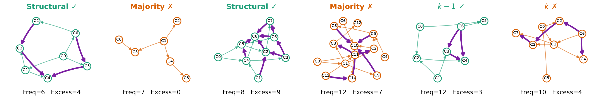
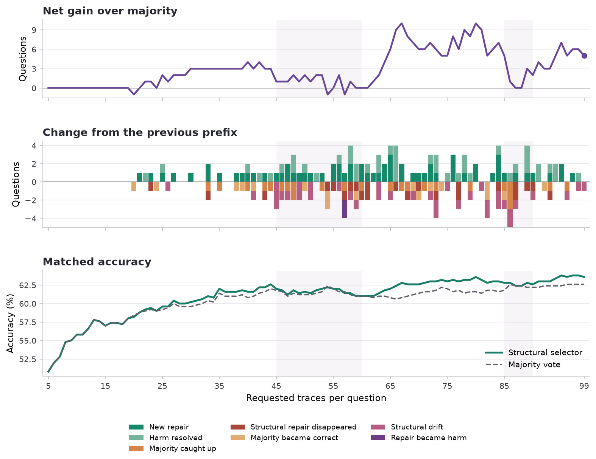

# Structural Signatures of Correct Mathematical Reasoning Traces

**Maria Marina and Alexander Panchenko · MathNLP 2026 · Budapest**

[Paper](https://aclanthology.org/2026.mathnlp-main.15/) · [Figure 1 notebook](notebooks/figure1.ipynb) · [Pipeline guide](docs/PIPELINE.md) · [Data dictionary](data/README.md) · [Reproduction audit](docs/REPRODUCTION.md)

## How do the steps leading to an answer vary?

When a model solves the same problem twice, it can take different steps to reach the same answer. In the first example below, $a, b, 2009$ form a geometric sequence with common ratio $r$. One solution writes $b=ar$ and $2009=br$, then substitutes to get $2009=ar^2$. Another writes $2009=ar^2$ directly. We group steps that express the same intermediate claim across traces ending in the same answer. Each recurring group is a **checkpoint**.

We hypothesize that correct solutions often share key checkpoints while varying in the steps that connect them. A wrong answer may collect many votes because several traces repeat the same mistaken sequence of steps with little variation.

In Figure 1, nodes are checkpoints. An arrow means that traces consistently visit two checkpoints in that order, sometimes consecutively and sometimes with another checkpoint in between. The thin arrows form a spanning tree connecting all the nodes in a panel. **Purple arrows are excess edges** that add alternative connections beyond the tree. Under each graph, `Freq` counts traces that produced the answer and `Excess` counts purple arrows.

In the first two pairs, the left panel (**Structural**) shows the less frequent answer selected by the method. The right panel (**Majority**) shows the most frequent answer. The first pair compares six votes for `41` with seven for `1`. The second compares eight votes for `501` with twelve for `499`. The final pair follows the selected answer from 40 to 41 traces.



*Figure 1. The first two pairs show repairs. The third shows a loss.*

[Vector figure](docs/assets/figure1.pdf) · [Rebuild the six panels](notebooks/figure1.ipynb)

## Choose a starting point

| What you have | Where to start | What you get |
|---|---|---|
| Public MATH500 problems and gold answers | Sample and grade completions, then run `build` and `replay` | A fresh experiment from the questions through accuracy and plots |
| An ordered CSV of graded completions | `build --model-cache … --reranker-model …`, then `replay` | New directional scores, checkpoints, precedence, decisions and accuracy |
| The bundled question 315 traces and frozen pair scores | `build --scores …`, then `replay` | The paper’s early repair on CPU, including the intermediate graph tables |
| The bundled answer and precedence tables for all 500 questions | `replay` or `python scripts/check_results.py` | All paper test decisions, with no model download |

The sampler reads one JSON object per problem with `problem` and `answer`. The structural method starts one step later, with **one row per completion** containing `id`, `completion`, `final_answer_new` and `row_hit`. Within each question, file order is draw order. The reranker compares reasoning steps. Gold labels enter the evaluation after selection. The guide gives the input download, commands for each step, model and graph arguments, metrics, and output filenames. [Run the full pipeline](docs/PIPELINE.md) · [Inspect a real row from each stage](data/README.md)

## Reproduce a decision on CPU

Run from the repository root in a new Python environment.

```bash
python -m venv .venv
source .venv/bin/activate
python -m pip install -e .

structural-signatures build --traces data/example/q315_traces.csv.gz \
  --scores data/example/q315_scores.csv.gz --budgets 5-25 --out runs/q315-graphs
structural-signatures replay --answers runs/q315-graphs/answers.csv.gz \
  --precedence runs/q315-graphs/precedence.csv.gz --preset historical_w3 \
  --budgets 5-25 --expected-ids 1 --out runs/q315-w3
```

At budget 25, `runs/q315-w3/predictions.csv.gz` gives `predicted_answer=41`, `majority_answer=1` and `repair=1`. The score for `41` is `0.666667`. The data dictionary walks through the votes and one of the directed edges behind that decision. [Question 315 and column definitions](data/README.md)

## Reproduce the paper results

```bash
python scripts/check_results.py
structural-signatures replay --answers data/math500/answers.csv.gz \
  --precedence data/math500/precedence.csv.gz --budgets 5-99 \
  --preset paper_w5 --expected-ids 500 --out runs/test-w5
python scripts/plot_performance.py --predictions runs/test-w5/predictions.csv.gz \
  --out runs/test-w5/performance.png
```

| Traces per question | Structural | Majority | Net gain |
|---|---:|---:|---:|
| 67 | 314 / 500 | 304 / 500 | +10 |
| 80 | 318 / 500 | 308 / 500 | +10 |
| 99 | 318 / 500 | 313 / 500 | +5 |

The five-prefix mean reproduces the net gain and both accuracies at all 95 budgets in Figure 2. At 99 traces, 17 repairs and 12 harms give a gain of one percentage point. Figure 1 and several diagnostics in the text use a three-prefix mean. The audit identifies which settings reproduce each result, including all 14 development rows in Table 1. [Numerical audit](docs/REPRODUCTION.md)



## Figures and tests

```bash
python -m pip install -e '.[notebook,test]'
jupyter lab notebooks/figure1.ipynb
python -m pytest -q
```

Run all notebook cells to rebuild Figure 1 from the saved precedence counts and export the PNG and PDF. The notebook checks all 72 directed arrows and the 27 purple excess edges against the published drawing.

The experiment builds on self-consistency, MATH, MATH500 and Qwen’s reranker. [Wang et al.](https://arxiv.org/abs/2203.11171) · [Hendrycks et al.](https://arxiv.org/abs/2103.03874) · [Lightman et al.](https://arxiv.org/abs/2305.20050) · [Zhang et al.](https://arxiv.org/abs/2506.05176)

## Citation

If you use the code or results, please cite the paper. [ACL Anthology](https://aclanthology.org/2026.mathnlp-main.15/) · [Download BibTeX](paper.bib)

```bibtex
@inproceedings{marina-panchenko-2026-structural,
  title     = {Structural Signatures of Correct Mathematical Reasoning Traces},
  author    = {Marina, Maria and Panchenko, Alexander},
  editor    = {Valentino, Marco and Ferreira, Deborah and Thayaparan, Mokanarangan
               and Ranaldi, Leonardo and Cheng, Jo-Ku and Freitas, Andre},
  booktitle = {The Proceedings of the 4th Workshop on Mathematical Natural
               Language Processing ({M}ath{NLP} 2026)},
  month     = oct,
  year      = {2026},
  address   = {Budapest, Hungary},
  publisher = {Association for Computational Linguistics},
  pages     = {194--200},
  doi       = {10.18653/2026.mathnlp-main.15},
  url       = {https://aclanthology.org/2026.mathnlp-main.15/},
  isbn      = {979-8-89176-468-2}
}
```
